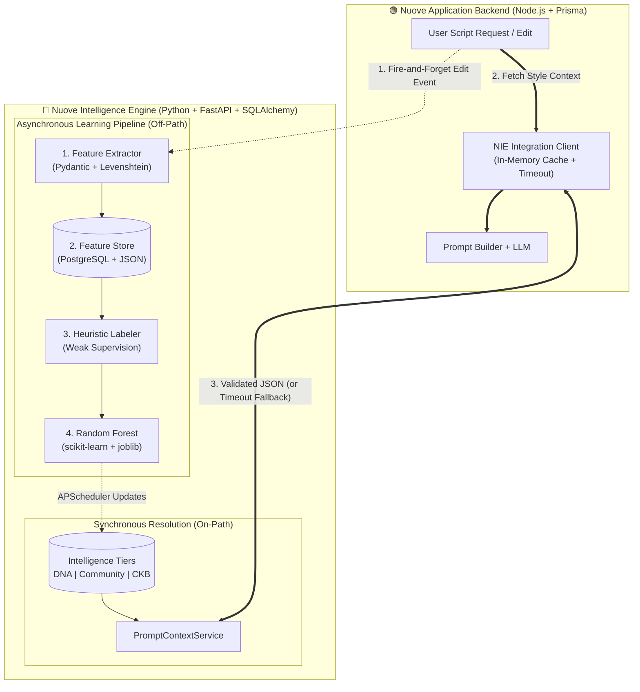
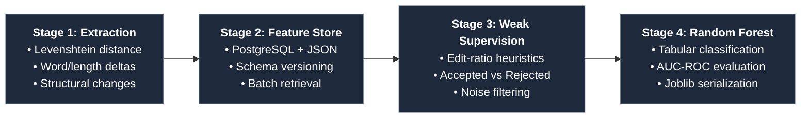
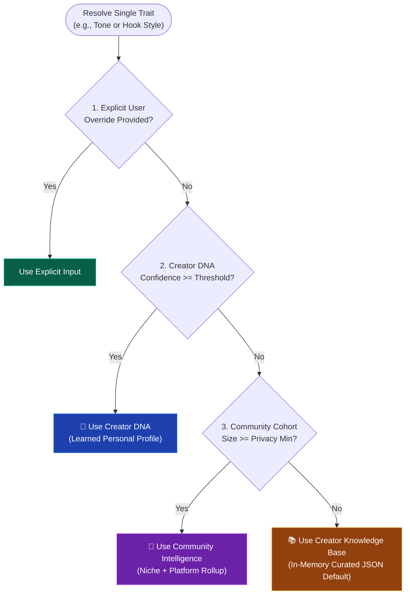
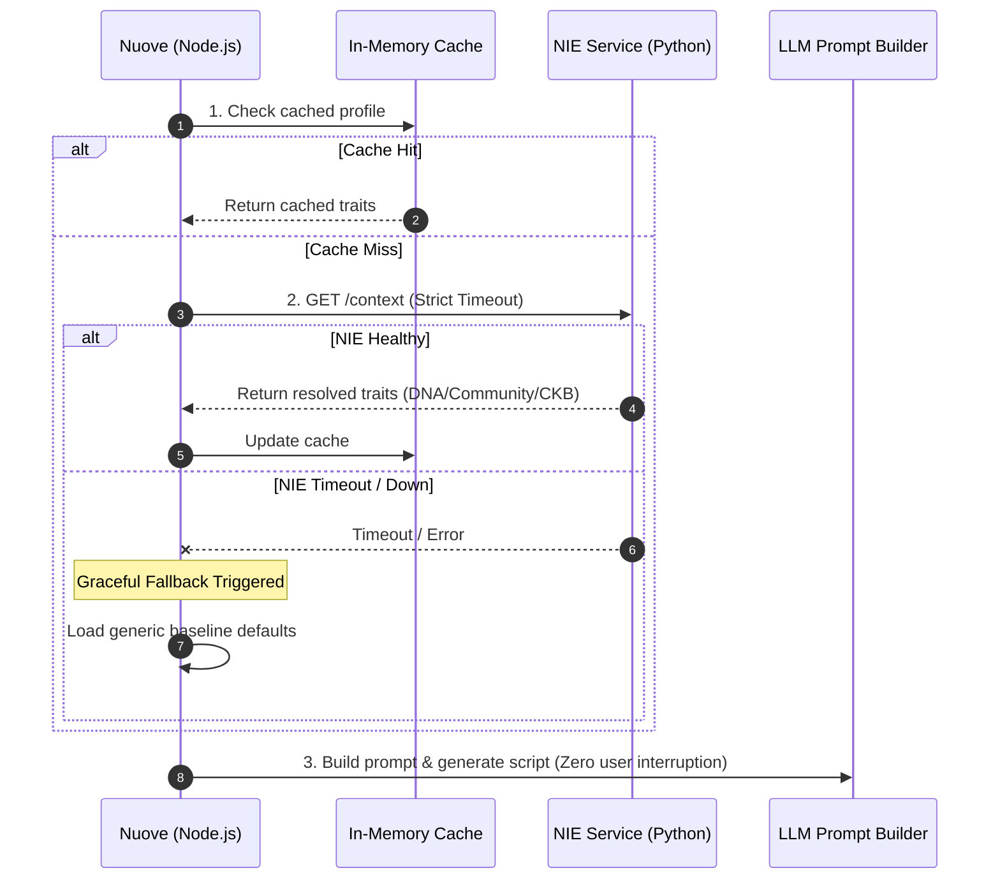

# Nuove Intelligence Engine (NIE)
### ML-Powered Creator Personalization Layer | Anahat Aura

> **Portfolio Case Study:** Architected and developed during my Machine Learning Engineering Internship at **Anahat Aura** for **Nuove**, an AI-powered short-form video script platform. 
> *Note: This repository is a system-design showcase. Proprietary source code, internal schemas, and business metrics are omitted.*

---

## ⚡ 15-Second Visual Summary

Standard LLM script generators rely on static prompts that forget a creator's style between sessions. **NIE** sits alongside Nuove's Node.js backend as a decoupled **Python (FastAPI) ML microservice**—learning from user edits asynchronously and injecting personalized style traits into LLM prompts at runtime without adding latency.

| Core Engineering Pillar | How NIE v1.0 Solves It |
| :--- | :--- |
| **Sparse Explicit Ratings** | Uses **Weak Supervision** (heuristic pseudo-labeling from edit distances) instead of waiting for thumbs-up/down ratings. |
| **Cold-Start Problem** | Trait-level waterfall fallback: **Creator DNA $\rightarrow$ Community Intelligence $\rightarrow$ Curated Knowledge Base (CKB)**. |
| **Zero-Latency Learning** | Decouples heavy ML training from user requests via **APScheduler** background jobs and non-blocking event ingestion. |
| **Fault Tolerance** | Strict timeouts, in-memory caching, and graceful degradation ensure Nuove generates scripts even if the ML service is down. |

---

## 🏗️ 1. System Architecture: Learning vs. Runtime

To keep script generation fast, NIE splits operations into two completely separate paths: an **Asynchronous Learning Loop** (blue) and a **Synchronous Runtime Delivery Path** (green/purple).

---

## 🔬 2. The 4-Stage ML Pipeline

Instead of black-box deep learning on limited initial data, NIE v1.0 uses interpretable, deterministic feature engineering paired with classical ensemble modeling.

<b>🔍 Click to expand technical details of each ML stage</b>

 

1. **Deterministic Feature Extraction:** Validates incoming interaction events via **Pydantic** and calculates lightweight signals (character/word deltas, structural modifications, and **Levenshtein edit distance** between original LLM drafts and user-edited scripts) without expensive NLP overhead.
2. **Centralized Feature Store:** Persists relational provenance metadata alongside flexible JSON feature vectors in **PostgreSQL** via **SQLAlchemy**, supporting schema version checks and batch retrieval.
3. **Semi-Supervised Heuristic Labeling:** Because creators rarely click explicit rating buttons, the pipeline infers approximate acceptance/rejection labels from edit ratios. Ambiguous edits are filtered conservatively to reduce label noise.
4. **Random Forest Classifier:** Trained asynchronously via **APScheduler** using `scikit-learn`. Selected for interpretability (feature importance), low compute overhead, and strong baseline performance on tabular behavioral features. Evaluated via **AUC-ROC** and serialized with `joblib`.

---

## 🧬 3. Cold-Start Waterfall (Trait-Level Resolution)

A creator might have enough history to know their preferred **Tone**, but not enough to know their preferred **Hook Style**. `PromptContextService` resolves **each trait independently** using a 4-step waterfall:

* **Privacy by Design:** Community Intelligence aggregates mature Creator DNA profiles by Niche and Platform, enforcing a **minimum group-size threshold** so small cohorts never leak an individual creator's behavior.

---

## 🛡️ 4. Production Reliability & Graceful Degradation

Personalization improves script generation, but **never acts as a single point of failure**.

---

## 👨‍💻 5. My Internship Contributions at Anahat Aura

During my Machine Learning Engineering Internship at **Anahat Aura**, I collaborated with the engineering team across the NIE v1.0 stack:

* **Feature Engineering & Contracts:** Built deterministic Python feature extraction modules (Levenshtein edit distance, structural deltas) and **Pydantic** validation schemas.
* **Feature Store & Persistence:** Contributed to **SQLAlchemy** models and batch-retrieval workflows for versioned feature storage in PostgreSQL.
* **Weak Supervision & Classical ML:** Worked on heuristic pseudo-labeling logic and the background **scikit-learn Random Forest** training and `joblib` serialization pipeline.
* **Cold-Start & Context Resolution:** Contributed to confidence-aware **Creator DNA** aggregation, privacy-thresholded **Community Intelligence** rollups, and trait-level fallback logic in `PromptContextService`.
* **Backend Integration & Testing:** Helped integrate the FastAPI service with Nuove's **Node.js** backend (async tracking, caching, timeouts) and authored **PyTest** validation suites and pipeline simulations.

---

## 🧰 6. Tech Stack & Scope Roadmap

| Category | Technologies Used in NIE v1.0 |
| :--- | :--- |
| **ML & Data Processing** | `Python` `scikit-learn` `Random Forest` `pandas` `NumPy` `python-Levenshtein` `joblib` |
| **API & Microservice** | `FastAPI` `Pydantic` `Uvicorn (ASGI)` `REST` |
| **Database & ORMs** | `PostgreSQL (Relational + JSON)` `SQLAlchemy (Python)` `Prisma (Node.js)` |
| **Integration & Ops** | `Node.js` `APScheduler` `In-Memory Caching` `PyTest` |

<b>🗺️ Click to view Implemented v1.0 Scope vs. Future Roadmap</b>

 

| Implemented in NIE v1.0 | Proposed Future Roadmap (Post-v1.0) |
| :--- | :--- |
| Deterministic edit-distance & structural features | Semantic style embeddings & vector representations |
| Heuristic pseudo-labeling (Weak Supervision) | Multi-candidate LLM draft scoring and reranking |
| Classical Random Forest via APScheduler | Distributed worker queues (Celery) & formal Model Registry |
| PostgreSQL JSON Feature Store + In-memory cache | Distributed Redis caching & dedicated analytical store |

<b>💡 Click to view Engineering Trade-offs & Lessons Learned</b>

 

* **Noisy Implicit Signals:** Edit distance is an effective proxy when explicit ratings are rare, but creators sometimes rewrite drafts because their topic changed. Conservative confidence thresholds around mid-range edits were crucial to prevent label noise.
* **Classical ML vs. Deep Learning:** Starting with a Random Forest over interpretable tabular features kept latency low and debuggability high on early-stage data, while leaving heavy semantic generation to the downstream LLM.
* **Strict Decoupling:** Keeping ML training off the synchronous request path ensured experimental model updates could never break core product uptime.

